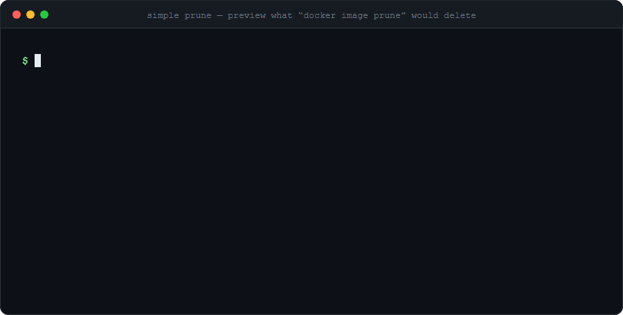

<p align="center">
  
</p>

<h1 align="center">simple prune</h1>

<p align="center">
  A Docker CLI plugin that shows what <code>docker image prune</code> and <code>docker image prune -a</code> would delete — <b>without deleting anything</b>.
</p>

<p align="center">
  <code>docker sp</code> · <code>docker simpleprune</code> &nbsp;|&nbsp; <a href="#italiano">Italiano ↓</a>
</p>

---

## Contents

- [Why](#why)
- [Install](#install)
- [Usage](#usage)
- [Example output](#example-output)
- [Recipes](#recipes)
- [How it works](#how-it-works)
- [Naming](#naming)
- [Standalone use](#standalone-use)
- [Limitations](#limitations)
- [Development](#development)
- [Italiano](#italiano)

## Why

`docker image prune -a` is one command away from deleting gigabytes of images,
and it gives you no way to look first. `simple prune` answers *"what would go?"*
using the same selection rules, and is strictly **read-only**: it never calls a
remove or prune API.

## Install

Requirements: Go **1.26+** to build (needed by `github.com/docker/cli` v29.9.x;
with `GOTOOLCHAIN=auto` Go fetches it for you) and a reachable Docker daemon.
`DOCKER_HOST` and the active docker context are honoured.

### Linux / macOS

Install the tools (`make` and Go 1.26+; skip what you already have):

```sh
# Debian / Ubuntu
sudo apt update && sudo apt install -y make git golang-go
# Fedora / RHEL
sudo dnf install -y make git golang
# Arch
sudo pacman -S --needed make git go
# macOS (Homebrew; make ships with the Xcode command line tools: xcode-select --install)
brew install go git
```

Distro Go packages can be older than 1.26: that is fine, Go will download the
required toolchain automatically (`go version` after the first build shows it),
or install a recent Go from <https://go.dev/dl/>.

Build and install:

```sh
git clone https://github.com/xClaudi0/simple-prune.git
cd simple-prune
make build      # -> bin/docker-simpleprune
make test       # go vet + go test
make install    # copies into ~/.docker/cli-plugins/ as docker-simpleprune AND docker-sp
make clean      # removes bin/
```

Installing somewhere else, or with a custom version string:

```sh
make install VERSION=0.2.0
make install PLUGINS=/usr/local/lib/docker/cli-plugins   # system-wide (use sudo)
```

Without `make`:

```sh
go build -trimpath -o bin/docker-simpleprune .
mkdir -p ~/.docker/cli-plugins
install -m 0755 bin/docker-simpleprune ~/.docker/cli-plugins/docker-simpleprune
install -m 0755 bin/docker-simpleprune ~/.docker/cli-plugins/docker-sp   # optional short alias
```

### Windows

With `make` (e.g. `choco install make` or `scoop install make`, run from Git Bash) use the same
`make` targets as above. Without `make` (PowerShell):

```powershell
go build -o bin\docker-simpleprune.exe .
New-Item -ItemType Directory -Force $HOME\.docker\cli-plugins | Out-Null
Copy-Item bin\docker-simpleprune.exe $HOME\.docker\cli-plugins\docker-simpleprune.exe
Copy-Item bin\docker-simpleprune.exe $HOME\.docker\cli-plugins\docker-sp.exe   # optional short alias
```

### Verify

Check with `docker --help`: `simpleprune` (and `sp`) should be listed under plugins.

## Usage

```
docker sp [-a|--all] [--filter key=value]... [--json]
```

| Option         | Effect                                                            |
|----------------|-------------------------------------------------------------------|
| *(none)*       | simulates `docker image prune` (unused **dangling** images)       |
| `-a`, `--all`  | simulates `docker image prune -a` (**all** unused images)         |
| `--filter`     | like `docker image prune --filter`; repeatable: `until=<duration\|timestamp>`, `label=<key>[=<value>]`, `label!=<key>[=<value>]` |
| `--json`       | prints JSON instead of a table                                    |

Unknown arguments or flags print an error plus the help on stderr and exit with code 1.
Timestamps are UTC; if the daemon reports no creation time the column shows `-`.

## Example output

Table (`docker sp -a`):

```
IMAGE ID       TAGS             CREATED               SIZE
7c3e91ab20d4   mongo:7          2026-05-13 18:11:47   1.3GB
b84f0a62c1e9   postgres:16      2026-04-07 01:39:11   649MB
5a6c1e8f4b77   <none>:<none>    2025-07-09 17:21:03   433MB

3 images would be removed by 'docker image prune -a' — total 2.38GB
(total is an overestimate: layers shared between images are counted more than once; at least 1.68GB is used only by these images and will certainly be freed)
```

Nothing to remove:

```
No images would be removed by 'docker image prune'.
```

JSON (`docker sp --json`):

```json
{
  "mode": "prune",
  "count": 1,
  "total_size": 433271803,
  "min_reclaimable": 433271803,
  "images": [
    {
      "id": "sha256:5a6c1e8f4b77…",
      "short_id": "5a6c1e8f4b77",
      "tags": [],
      "created": "2025-07-09T17:21:03Z",
      "size": 433271803,
      "unique_size": 433271803
    }
  ]
}
```

With an empty result: `"count": 0, "total_size": 0, "images": []`. `unique_size` (per image) and `min_reclaimable` are omitted when the daemon does not report shared sizes. `mode` is `"prune"` or `"prune -a"`.

## Recipes

Real combinations to see what would happen. Nothing below deletes anything.
(`jq` is optional and only used to post-process the JSON.)

**What would plain `docker image prune` remove?**

```sh
docker sp
```

**What would `docker image prune -a` free, in numbers?**

```sh
docker sp -a --json | jq '{count, total_size, min_reclaimable}'
```
```json
{ "count": 21, "total_size": 10979900469, "min_reclaimable": 9117281712 }
```

**The 3 biggest images that `-a` would delete**

```sh
docker sp -a --json | jq -r '.images[:3][] | "\(.short_id)  \(.tags[0] // "<none>")  \(.size / 1e9 * 100 | round / 100) GB"'
```
```
202bef359512  public.ecr.aws/supabase/studio:2026.06.03-sha-0bca601  1.64 GB
4145c58737fc  thijsvanloef/palworld-server-docker:latest  1.3 GB
d6566e93e6a9  mongo:latest  1.3 GB
```

**Only the untagged images that `-a` would remove (count)**

```sh
docker sp -a --json | jq '[.images[] | select(.tags | length == 0)] | length'
```

**Keep anything labelled `keep=true`, ignore images added in the last 24h**

```sh
docker sp -a --filter 'label!=keep=true' --filter until=24h
```

**Only images with a given label**

```sh
docker sp -a --filter label=com.docker.compose.project
```

**Preview, then prune with the exact same filters** (the preview is a separate, read-only step)

```sh
docker sp -a --filter until=720h          # look first
docker image prune -a --filter until=720h # then run the real thing
```

**Fail a script if there is something to clean** (exit code is always 0 on success, so test the count)

```sh
test "$(docker sp --json | jq .count)" -eq 0 || echo "dangling images found"
```

**Run against another daemon or context**

```sh
DOCKER_HOST=ssh://user@build-server docker sp -a
docker --context staging sp --json
```

**Mistyped option: error, help on stderr, exit code 1**

```sh
docker sp --nope; echo $?
```

## How it works

1. List **all** containers (including stopped ones) → set of full image IDs (`sha256:…`).
2. List images: daemon-side filter `dangling=true` by default, no filter with `-a`.
3. To remove = candidates whose ID is not in the set from step 1. Comparison is always by ID, never by name/tag.
4. Deduplicate by ID (a multi-tag image is one entry), sort by size, descending.

The selection logic (`internal/prune/select.go`) only depends on a small `Daemon`
interface, so it is unit-tested without Docker. The real client is wrapped so that
only `ContainerList` and `ImageList` are reachable.

## Naming

The project is **simple prune**. The Docker CLI only accepts plugin names matching
`^[a-z][a-z0-9]*$` (a hyphenated `simple-prune` or `prune-preview` is rejected), so:

| Binary                  | Command              |
|-------------------------|----------------------|
| `docker-simpleprune`    | `docker simpleprune` |
| `docker-sp`             | `docker sp`          |

It is the same executable: the command name is derived from the file name.

## Standalone use

The plugin framework handles the metadata handshake and builds the client from the
same configuration as the CLI. The binary also runs directly, but the command name
must be passed as first argument:

```sh
docker-sp sp --json
```

Standalone, `DOCKER_HOST` / `DOCKER_CONTEXT` / `DOCKER_CONFIG` are honoured, but
global flags such as `-H` or `--context` given to `docker` are not available.

## Limitations

- `total_size` is an **overestimate**: shared layers are counted once per image. The plugin also asks the daemon for each image's shared size and reports `min_reclaimable` (sum of `size - shared size`): a lower bound of what is certainly freed. The real figure lies between the two, because layers shared only among the removed images are freed too but cannot be measured through the API.
- With the containerd image store the same image ID can have both a tagged and a dangling
  record, and the daemon's `dangling=true` filter returns the untagged one. Plain `prune`
  only drops dangling records, so the image would stay. The plugin therefore also excludes,
  in the default mode, every ID that has at least one tag in the full image list. This
  behaviour is inferred from the API data, not verified by running a real prune.
- `--filter` is evaluated by the daemon, exactly as for `docker image prune`. On the containerd
  image store `until` appears to use the time the image entered the store, not its `Created` date
  (so a 2021 image pulled last month is not "older than 1 year"). Unknown filter keys are rejected.

## Development

```
main.go                      # cobra command + plugin metadata
internal/prune/select.go     # selection logic + Daemon interface
internal/prune/render.go     # table and JSON output
internal/prune/docker.go     # adapter to github.com/moby/moby/client
assets/banner.gif            # animated banner used in this README
assets/banner.svg            # same banner as vector SVG/CSS animation
LICENSE                      # MIT
```

SDK: [`github.com/moby/moby/client`](https://pkg.go.dev/github.com/moby/moby/client)
(`github.com/docker/docker` stops at v28.5.2). `make test` runs `go vet` and the unit tests.

---

<a id="italiano"></a>

# Italiano

**simple prune** è un plugin per la Docker CLI che mostra cosa verrebbe rimosso da
`docker image prune` e `docker image prune -a`, **senza rimuovere nulla**.
È strettamente in sola lettura: non chiama mai API di rimozione o di prune.

## Installazione

Per compilare serve Go **1.26+** (richiesto da `github.com/docker/cli` v29.9.x; con
`GOTOOLCHAIN=auto` lo scarica Go stesso) e un daemon Docker raggiungibile.
`DOCKER_HOST` e il docker context attivo vengono rispettati.

**Linux / macOS** — installa gli strumenti (`make` e Go 1.26+):

```sh
# Debian / Ubuntu
sudo apt update && sudo apt install -y make git golang-go
# Fedora / RHEL
sudo dnf install -y make git golang
# Arch
sudo pacman -S --needed make git go
# macOS (Homebrew; make arriva con gli Xcode command line tools: xcode-select --install)
brew install go git
```

Se il Go della distro è più vecchio di 1.26 non è un problema: scarica da solo la toolchain richiesta
(oppure installa Go da <https://go.dev/dl/>). Poi:

```sh
git clone https://github.com/xClaudi0/simple-prune.git
cd simple-prune
make build      # -> bin/docker-simpleprune
make test       # go vet + go test
make install    # copia in ~/.docker/cli-plugins/ come docker-simpleprune E docker-sp
make clean      # rimuove bin/
```

Altra destinazione o versione: `make install VERSION=0.2.0`,
`make install PLUGINS=/usr/local/lib/docker/cli-plugins` (di sistema, con `sudo`).

Senza `make`:

```sh
go build -trimpath -o bin/docker-simpleprune .
mkdir -p ~/.docker/cli-plugins
install -m 0755 bin/docker-simpleprune ~/.docker/cli-plugins/docker-simpleprune
install -m 0755 bin/docker-simpleprune ~/.docker/cli-plugins/docker-sp   # alias opzionale
```

**Windows**: con `make` (`choco install make` / `scoop install make`, da Git Bash) valgono gli stessi
target; senza `make` vedi i comandi PowerShell nella sezione [Install](#install).

Verifica con `docker --help`: `simpleprune` (e `sp`) compaiono tra i plugin.

## Uso

```
docker sp [-a|--all] [--filter key=value]... [--json]
```

| Opzione        | Effetto                                                              |
|----------------|----------------------------------------------------------------------|
| *(nessuna)*    | simula `docker image prune` (immagini **dangling** non usate)        |
| `-a`, `--all`  | simula `docker image prune -a` (**tutte** le immagini non usate)     |
| `--filter`     | come `docker image prune --filter`, ripetibile: `until=`, `label=`, `label!=` |
| `--json`       | output JSON invece della tabella                                     |

Argomenti o flag sconosciuti: errore + help su stderr, exit code 1.
Date in UTC; se il daemon non fornisce la data di creazione la colonna mostra `-`.
L'output del tool è in inglese (vedi [Example output](#example-output)).

## Esempi pratici

Combinazioni reali per vedere cosa succede (nessuna cancella nulla; `jq` è opzionale):

```sh
docker sp                                                   # cosa toglierebbe `docker image prune`
docker sp -a --json | jq '{count, total_size, min_reclaimable}'   # numeri di `prune -a`
docker sp -a --json | jq -r '.images[:3][] | "\(.short_id) \(.tags[0] // "<none>") \(.size)"'  # le 3 più grandi
docker sp -a --filter 'label!=keep=true' --filter until=24h # escludi label keep, ignora le ultime 24h
docker sp -a --filter until=720h && docker image prune -a --filter until=720h   # prima guarda, poi pulisci
DOCKER_HOST=ssh://utente@server docker sp -a                # su un altro daemon
docker --context staging sp --json                          # su un altro context
test "$(docker sp --json | jq .count)" -eq 0 || echo "ci sono immagini da pulire"   # controllo negli script
```

## Come funziona

1. Lista di **tutti** i container (anche stopped) → insieme degli image ID `sha256:…`.
2. Lista immagini: filtro `dangling=true` di default, nessun filtro con `-a`.
3. Da rimuovere = immagini candidate il cui ID non è nell'insieme del punto 1. Confronto sempre per ID, mai per nome/tag.
4. Deduplica per ID (un'immagine con più tag è una sola voce), ordinamento per size decrescente.

## Nome del comando

Il progetto si chiama **simple prune**. La Docker CLI accetta solo nomi di plugin che
rispettano `^[a-z][a-z0-9]*$` (`simple-prune` o `prune-preview` con il trattino vengono
rifiutati), quindi i comandi sono `docker simpleprune` e la abbreviazione `docker sp`.
È lo stesso eseguibile: il nome del comando deriva dal nome del file.

## Esecuzione standalone

Il binario è eseguibile anche direttamente, passando il nome del comando come primo
argomento: `docker-sp sp --json`. In questo caso valgono `DOCKER_HOST` / `DOCKER_CONTEXT` /
`DOCKER_CONFIG`, ma non i flag globali di `docker` (`-H`, `--context`).

## Limiti noti

- `total_size` è una **sovrastima**: i layer condivisi sono contati per ciascuna immagine. Il plugin chiede al daemon anche la dimensione condivisa di ogni immagine e riporta `min_reclaimable` (somma di `size - shared size`): un limite inferiore di ciò che viene liberato di sicuro. Il valore reale sta tra i due, perché i layer condivisi solo tra immagini rimosse vengono liberati ma non sono misurabili via API.
- Con lo store containerd lo stesso image ID può avere un record con tag e uno dangling, e il filtro
  `dangling=true` del daemon restituisce quello senza tag. `prune` semplice rimuove solo i record
  dangling, quindi l'immagine resterebbe: il plugin esclude in modalità base ogni ID che ha almeno
  un tag nella lista completa. Comportamento dedotto dai dati dell'API, non verificato con un prune reale.
- `--filter` (`until`, `label`, `label!`) è valutato dal daemon, come in `docker image prune`. Con lo store
  containerd `until` sembra usare il momento in cui l'immagine è entrata nello store, non la data `Created`.
